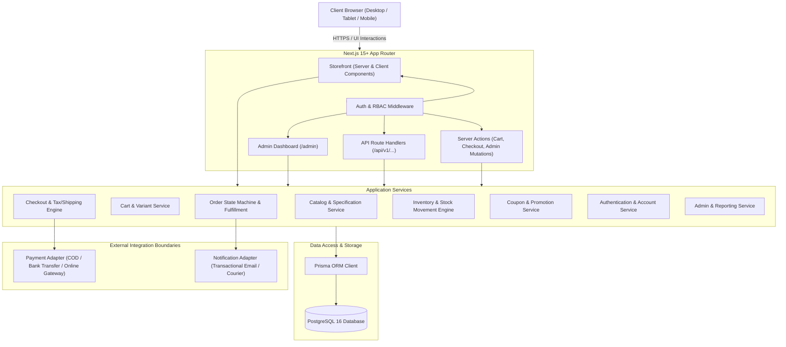

# VoltEdge — System Architecture Specification

## 1. Overview & System Mission

VoltEdge is an enterprise-grade, high-performance e-commerce platform engineered specifically for computer hardware, PC components, gaming peripherals, and technology accessories in Pakistan. The platform is designed with a modern modular monolith architecture using Next.js (App Router), TypeScript, Tailwind CSS, PostgreSQL, and Prisma ORM.

## 2. Core Architectural Principles

1. **Separation of Concerns**: Presentation (React Server/Client Components), Business Logic (Server Services), and Data Access (Prisma Repositories) are strictly isolated.
2. **Authoritative Server**: All financial calculations, inventory checks, coupon validations, shipping rates, and taxes are strictly executed on the server. The client is treated as untrusted.
3. **Transactional Integrity**: Critical multi-step mutations (checkout, inventory deduction, order state transitions) run inside atomic SQL transactions with concurrency control.
4. **Security by Design**: 
   - Sensitive database clients, API secrets, and private keys never leak to client bundles.
   - Strict server-side RBAC (Role-Based Access Control) guarding customer and admin interfaces.
   - Protection against SQL injection, CSRF, XSS, and mass-assignment.
   - HttpOnly, SameSite, Secure cookie-based authentication.
5. **Resilient Local & Production Support**:
   - PostgreSQL 16 via Docker Compose or native hosting.
   - Embedded development database runner for instant zero-dependency local verification.

## 3. High-Level Architecture Diagram

## 4. Logical Module Breakdown

- **Storefront & Catalog**:
  - High-performance server-rendered category and product pages with responsive filters tailored for computer specifications (GPU VRAM, CPU Socket, RAM DDR generation, Monitor refresh rate, etc.).
  - Instant live debounced search across titles, brands, SKUs, and categories.
  - Interactive product detail pages with variant selectors, technical specification matrices, verified review components, and real-time stock indicators.
- **Cart & Checkout**:
  - Resilient cart supporting both anonymous sessions and logged-in customer carts with smart server-side merge on authentication.
  - Multi-step, frictionless checkout built for Pakistani logistics (Province, City, Area, Street, Postal Code, Phone validation `+92 / 03xx`).
  - Cash on Delivery (COD), Direct Bank Transfer with payment proof upload/reference, and pluggable Card/Wallet integration interfaces.
- **Administrative Hub**:
  - Secure role-guarded `/admin` portal.
  - Executive KPI dashboards (Revenue, AOV, Pending Orders, Low-stock triggers).
  - Complete catalog management (Products, Variants, Categories, Brands, Specifications).
  - Granular inventory ledger recording each movement and manual audit adjustments with reasons.
  - Order fulfillment workflow with decoupled Order Status and Payment Status state machines.
  - Promotional discount coupon engine with usage limits, date windows, and category restrictions.
  - CSV reporting and sales analytics.

## 5. Technology Stack Summary

| Layer | Technology |
|---|---|
| Framework | Next.js (App Router) |
| Language | TypeScript 5 (Strict Mode) |
| Styling | Tailwind CSS & Custom High-Tech Design Tokens |
| UI Components | Lucide React, Radix UI / shadcn patterns |
| ORM | Prisma 5/6 |
| Database | PostgreSQL 16 |
| Validation | Zod |
| Forms | React Hook Form & Zod Resolvers |
| Currency / Locale | PKR (Pakistani Rupee) / en-PK |
