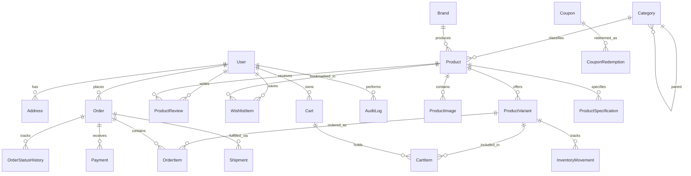

# VoltEdge — PostgreSQL Database Design Specification

## 1. Design Overview

The VoltEdge database is designed for PostgreSQL 16 using Prisma ORM. It prioritizes financial precision, transactional safety, referential integrity, and efficient querying across technical hardware specifications.

## 2. Core Modeling Rules

1. **Monetary Precision**: All monetary values (`price`, `salePrice`, `unitPrice`, `discountAmount`, `shippingFee`, `taxAmount`, `totalAmount`, `subtotal`) use PostgreSQL `Decimal(12, 2)` / Prisma `Decimal`. Floating-point math is prohibited for currency calculations.
2. **Identification**:
   - UUID v4 (`cuid` / `uuid`) for internal record keys.
   - Stable, URL-friendly unique `slug` for Products, Categories, and Brands.
   - Human-readable order numbers (e.g. `VE-20261024-XXXX`).
   - Unique SKU per sellable product variant.
3. **Data Immutability & Snapshots**:
   - Order items snapshot product title, variant details, SKU, unit price, and discount at the exact moment of order placement. Subsequent catalog edits never distort historical financial records.
4. **Soft Deletions / Archival**:
   - Products and categories are archived (`isActive: false` or `isArchived: true`) rather than hard deleted to preserve referential integrity of past orders and reviews.
5. **Decoupled Order and Payment Lifecycles**:
   - Order Status (`PENDING`, `CONFIRMED`, `PROCESSING`, `SHIPPED`, `DELIVERED`, `CANCELLED`, `RETURNED`) is completely decoupled from Payment Status (`PENDING`, `AWAITING_VERIFICATION`, `PAID`, `FAILED`, `REFUNDED`).
6. **Auditable Inventory Movements**:
   - Every stock alteration (sales deduction, cancellation restock, shipment return, manual administrative adjustment) creates an `InventoryMovement` entry with quantity, reason, and admin reference.

## 3. Relational Entity Relationship Diagram

## 4. Entity Schema Catalog

### 4.1 Authentication & Identity
- **User**: `id`, `name`, `email` (unique, lowercase), `passwordHash`, `phone`, `role` (`CUSTOMER` | `ADMIN` | `STAFF`), `isActive`, `emailVerified`, `createdAt`, `updatedAt`.
- **Address**: `id`, `userId`, `recipientName`, `phone`, `province`, `city`, `area`, `streetAddress`, `postalCode`, `isDefaultShipping`, `isDefaultBilling`, `deliveryInstructions`.

### 4.2 Product Catalog & Hardware Specifications
- **Category**: `id`, `name`, `slug` (unique), `description`, `imageUrl`, `parentId`, `sortOrder`, `isActive`.
- **Brand**: `id`, `name`, `slug` (unique), `logoUrl`, `website`, `isActive`.
- **Product**: `id`, `title`, `slug` (unique), `shortDescription`, `description`, `brandId`, `categoryId`, `basePrice`, `salePrice`, `sku`, `stock`, `lowStockThreshold`, `isFeatured`, `isActive`, `warrantyMonths`, `createdAt`, `updatedAt`.
- **ProductVariant**: `id`, `productId`, `name` (e.g. "16GB Black / Cherry MX Red"), `sku` (unique), `priceAdjustment`, `stock`, `attributes` (JSONB).
- **ProductSpecification**: `id`, `productId`, `groupName` (e.g. "Performance", "Connectivity"), `specKey` (e.g. "VRAM", "Socket", "Refresh Rate"), `specValue` (e.g. "16GB GDDR6X", "AM5", "240Hz"), `sortOrder`.
- **ProductImage**: `id`, `productId`, `url`, `altText`, `sortOrder`, `isPrimary`.
- **ProductReview**: `id`, `productId`, `userId`, `rating` (1-5), `title`, `comment`, `isVerifiedPurchase`, `isApproved`, `createdAt`.

### 4.3 Shopping, Cart & Discounts
- **Cart**: `id`, `userId` (nullable for anonymous guests), `sessionToken` (for anonymous tracking), `expiresAt`, `createdAt`, `updatedAt`.
- **CartItem**: `id`, `cartId`, `productId`, `variantId` (nullable), `quantity`, `addedAt`.
- **Coupon**: `id`, `code` (unique, uppercase), `discountType` (`PERCENTAGE` | `FIXED`), `discountValue`, `minOrderAmount`, `maxDiscountAmount`, `startDate`, `endDate`, `usageLimit`, `perCustomerLimit`, `timesUsed`, `isActive`.
- **CouponRedemption**: `id`, `couponId`, `userId`, `orderId`, `discountAmount`, `redeemedAt`.

### 4.4 Orders, Fulfillment & Payments
- **Order**: `id`, `orderNumber` (unique), `userId`, `customerName`, `customerEmail`, `customerPhone`, `shippingProvince`, `shippingCity`, `shippingArea`, `shippingAddress`, `shippingPostalCode`, `deliveryNotes`, `subtotal`, `discountAmount`, `shippingFee`, `taxAmount`, `totalAmount`, `status` (`PENDING_CONFIRMATION`, `CONFIRMED`, `PROCESSING`, `SHIPPED`, `DELIVERED`, `CANCELLED`, `RETURNED`), `paymentStatus` (`PENDING`, `AWAITING_VERIFICATION`, `PAID`, `FAILED`, `REFUNDED`), `paymentMethod` (`CASH_ON_DELIVERY`, `BANK_TRANSFER`, `ONLINE_CARD`), `couponCode`, `internalNotes`, `createdAt`, `updatedAt`.
- **OrderItem**: `id`, `orderId`, `productId`, `variantId` (nullable), `productTitle`, `variantName` (nullable), `sku`, `unitPrice`, `quantity`, `totalPrice`.
- **OrderStatusHistory**: `id`, `orderId`, `status`, `notes`, `changedByUserId`, `createdAt`.
- **Payment**: `id`, `orderId`, `amount`, `currency` (PKR), `provider` (`COD`, `MANUAL_BANK`, `STRIPE_OR_GATEWAY`), `transactionReference`, `status`, `paymentProofUrl`, `receivedAt`.
- **Shipment**: `id`, `orderId`, `courierName` (e.g. TCS, Leopard, Trax), `trackingNumber`, `shippedAt`, `estimatedDelivery`, `deliveredAt`.
- **InventoryMovement**: `id`, `variantId` (or `productId`), `quantityDelta`, `resultingStock`, `movementType` (`PURCHASE_DEDUCTION`, `ORDER_CANCEL_RESTOCK`, `MANUAL_ADJUSTMENT`, `RETURN_RESTOCK`), `reason`, `referenceOrderId`, `adminUserId`, `createdAt`.
- **AuditLog**: `id`, `userId`, `action`, `entityType`, `entityId`, `details` (JSONB), `ipAddress`, `createdAt`.
- **StoreSetting**: `id`, `key` (unique), `value` (JSONB), `description`, `updatedAt`.

## 5. Indexing Strategy

- `Product`: Indexes on `slug` (unique), `categoryId`, `brandId`, `basePrice`, `isFeatured`, `isActive`, `createdAt`.
- `ProductSpecification`: Index on `(productId, specKey)` and `(specKey, specValue)`.
- `Order`: Indexes on `orderNumber` (unique), `userId`, `status`, `paymentStatus`, `createdAt`.
- `InventoryMovement`: Index on `(productId, createdAt)` and `referenceOrderId`.
- `CartItem`: Index on `(cartId, productId, variantId)`.
